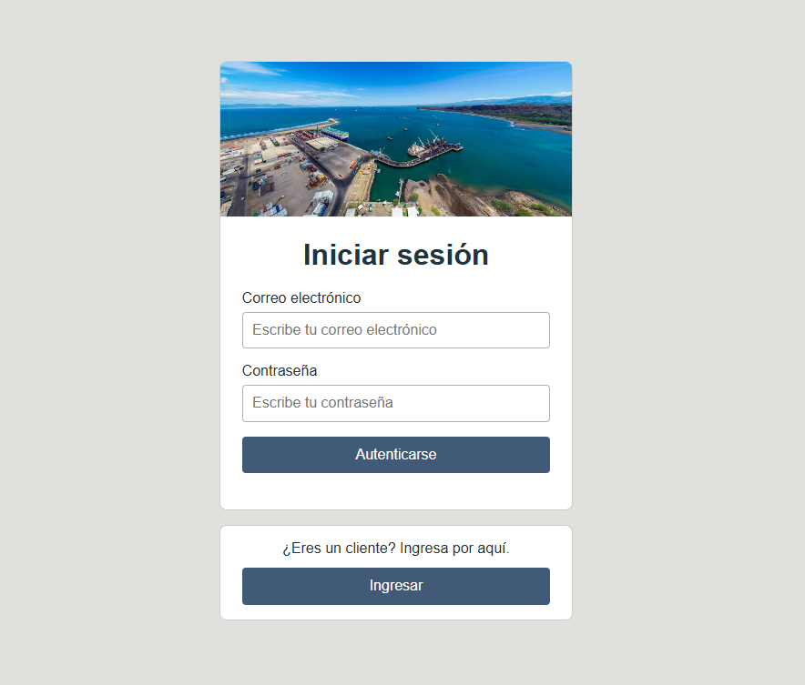
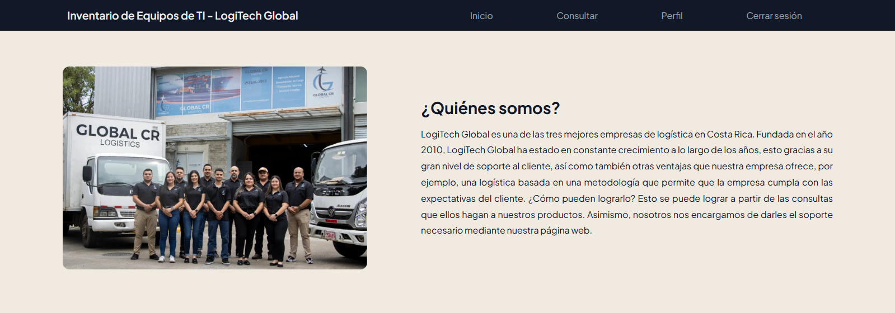
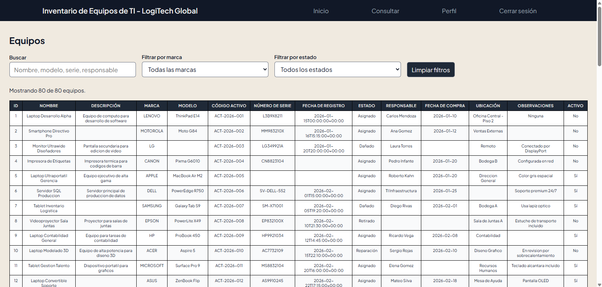
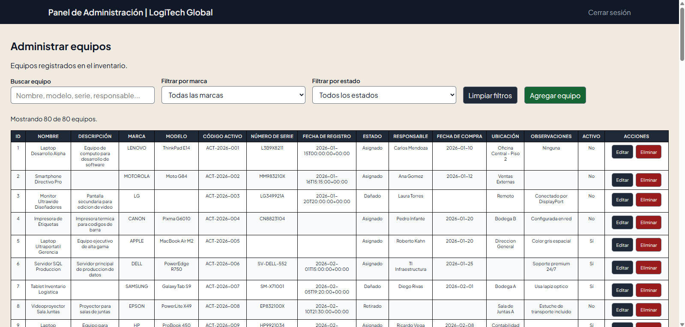

# Documentación Oficial de LogiTec Global
## Ronald Eduardo Condega Paizano

## HERRAMIENTAS
Para poder desarrollar el proyecto, es necesario destacar las herramientas que se utilizaron durante el desarrollo de este:

Primero, es importante contar con este editor de código, el cual nos permitirá trabajar de manera gratuita. [Visual Studio Code](https://code.visualstudio.com/)

Segundo, se debe de tener un lugar que sea adecuado para el guardado de el proyecto; es decir, un repositorio. Asimismo, esta herramienta también permitirá que subir los cambios que se van desarrollando a lo largo del proyecto. [Github](https://github.com/5onald/Mantenimiento-de-Inventario)

Tercero, pero no menos importante, se debe de tener en cuenta una base de datos para poder guardar todos los registros. Así como también para realizar consultas, crear o actualizar datos, y también poder eliminarlos. [Supabase](https://supabase.com/dashboard/project/kprmjuplxnyrszualoce)

## OBJETIVO
    Un encargado de tecnología requiere una aplicación pequeña y funcional para registrar, consultar, modificar e inactivar equipos tecnológicos. Esta herramienta le permitirá mantener actualizado el inventario en tiempo real a partir de las existencias, características, ubicación, responsable y estado actual de cada equipo.

 

---

 

## ETAPA I - BASE DE DATOS
En esta etapa, se desarrollará primero la base de datos y las tablas, las cuales serán esensiales para la aplicación del encargado.

    Tabla: marcas
~~~
create table public.marcas (
  "idMarcas" bigint generated by default as identity not null,
  "Marca" character varying not null,
  constraint "Tabla Marcas_pkey" primary key ("idMarcas"),
  constraint "Tabla Marcas_created_at_key" unique ("Marca")
) TABLESPACE pg_default;
~~~

 

    Tabla: estado_quipo
~~~
create table public.estado_equipo (
  "idEstado" bigint generated by default as identity not null,
  "Estado" character varying not null,
  constraint "EstadoEquipo_pkey" primary key ("idEstado")
) TABLESPACE pg_default;
~~~

 

    Tabla: equipos
~~~
create table public.equipos (
  "idEquipo" bigint generated by default as identity not null,
  "Nombre" character varying not null,
  "Descripcion" text null,
  "idMarcas" bigint null,
  "Modelo" character varying null,
  "CodigoActivo" character varying not null,
  "NumeroSerie" character varying null,
  "FechaRegistro" timestamp with time zone null,
  "idEstado" bigint not null,
  "Responsable" character varying null,
  "FechaCompra" date null,
  "Ubicacion" character varying null,
  "Observaciones" text null,
  "Activo" boolean not null,
  constraint "Tabla Equipos_pkey1" primary key ("idEquipo"),
  constraint "Tabla Equipos_CodigoActivo_key1" unique ("CodigoActivo"),
  constraint "Tabla Equipos_NumeroSerie_key1" unique ("NumeroSerie"),
  constraint "Tabla Equipos_idEstado_fkey1" foreign KEY ("idEstado") references estado_equipo ("idEstado"),
  constraint "Tabla Equipos_idMarcas_fkey1" foreign KEY ("idMarcas") references marcas ("idMarcas")
) TABLESPACE pg_default;
~~~
 

No obstante, se creó un usuario para el sistema de autenticación; es decir, que solamente el encargado de tecnología podrá ingresar como administrador en la aplicación. Asimismo, el sistema ya tendrá guardado que este usuario admin podrá insertar, leer, actualizar y eliminar todos los datos de todas las tables a partir de las políticas RLS (Row-Level Security policies). Sin embargo, para ingresar como administador, se necesita:

    Correo electrónico: alejandrosolanor@gmail.com

    Contraseña: Huq73627?

 

---

 

## ETAPA II - DESARROLLO DE LA APLICACIÓN
Para esta etapa, es importante escoger los lenguajes que se van a utilizar para poder desarrollar la aplicación. Ahora, ¿qué lenguajes se van a estar utilizando? HTML, CSS y JavaScript. HTML servirá para darle el esqueleto a la aplicación; el CSS permitirá que tenga una apariencia visual mucho más clara; y por último, pero no menos importante, JavaScript permitirá darle vida a todas las características que requieren un comportamiento un poco más complejo.

### HTML & CSS
    1page_login

Antes de iniciar, es importante saber cómo está compuesto el inicio de sesión de la página principal. Esto debido a que esta está compuesta por dos secciones, las cuales son "login-section" y "next-section". Ahora bien, ¿cómo puedo saber cuál es una de ellas? Bueno, a continuación se le presentará un breve explicación.

| Sección | Explicación |
| --- | --- |
| login-section | Esta sección está compuesta por el contenedor de "Iniciar sesión", el cual es el que se encuentre en la parte superior de los 2 contenedores vistos en la imagen. Ahora bien, este contenedor cuenta con una imagen de Puerto de Caldera para hacer alusión a LogiTec Global. No obstante, esta cuenta con un formulario que permite al usuario admin ingresar sus crendenciales, cuyas fueron creadas anteriormente. Las cuales se tratan de su correo electrónico y la contraseña. Para cuando el usuario tenga ambos campos con las credenciales, deberá de presionar le botón de "Autenticarse" para ingresar a su cuenta. En caso contrario de que las credenciales fallen, posiblemente sea porque no es un usuario admin o las credenciales están mal escritas. |
| next-section | Esta sección está compuesta por el contenedor de "Ingreso de clientes", el cual es el que se encuentre en la parte inferior de los 2 contenedores vistos en la imagen. Ahora bien, este contenedor cuenta con un mensaje que dice "¿Eres un cliente? Ingresa por aquí", esto permite que solamente los usuarios que sean clientes puedan ingresar por esa parte y ser dirigidos a otra página no administadora. Esta función se cumple a partir de la persona cuenta esta presiona el botón "Ingresar". |
|

 

---

 

    2page_homepage

Ahora, se observará como es la página de inicio para los clientes, la cual es como una breve introducción de la empresa LogiTech Global. Esta está compuesta por secciones, las cuales son "header" y "main". ¿Y si no sé cuál es una o la otra? Bueno, a continuación se le presentará un breve explicación.

| Sección | Explicación |
| --- | --- |
| header | Esta sección es la que se puede notar fácilmente de la otra debido a su color azul muy oscuro de fondo. Ahora bien, en esta sección se podrá notar un título de "Inventario de Equipos de TI - LogiTech Global", lo cual da a entender el propósito de la aplicación, así como también añadiendo el nombre de la empresa que se encarga de hacer dicho inventario. No obstante, también se podrá observar un menú de navegación, el cual este permite que los usuarios dirigidos a otras páginas de la aplicación. Por ejemplo, se puede observar: Inicio, que actualmente se encuentra el usuario y muestra información de lo que es la empresa; consultar, donde el usuario podrá consultar sobre los equipos tecnológicos y en el cual dirigirá al usaurio a "3page_queries"; perfil, donde los usuarios podrán ver la información de ellos (sin embargo, esta página no fue creada); y por último, cerrar sesión, el cual permite que los usuarios se puedan retirar de la página sin ninguna dificultada. Ahora, ¿para dónde van los usuarios después de cerrar sesión? Bueno, ellos serán dirigidos a la "1page_login". |
| main | Por otra parte, esta sección destaca con mayor facilidad gracias a su fondo blanco glamuroso. En ella, se muestra una imagen del personal administrativo, el equipo clave para que LogiTech Global funcione con un rendimiento logístico superior. También, se muestra una pregunta de quiénes somos y una explicación del por qué son unas de las 3 mejores empresas de logística en Costa Rica. |
|

 

---

 

    3page_queries

Por otra parte, 

| Sección | Explicación |
| --- | --- |
| header | Como se mencionó anteriormente, en el header aparece el título de "Inventario de Equipos de TI - LogiTech Global", así como también se podrá observar un menú de navegación que permite dirigir al usuario a otras páginas de la aplicación. |
| consultas | Ahora bien, en esta sección aparecen los filtros que permite a los usuarios buscar el nombre de un equipo, modelo, número de serie y responsable. No obstante, también se destaca el hecho de ellos no solamente pueden filtrar por los datos ya mencionados, sino que también pueden filtrar equipos por su marca y su estado. Esto permite que una consulta que puede durar aproximadamente más de 5 horas, uno usuario pueda hacer la consulta en menor tiempo. Permitiendo eficiencia lo más pronto posible. |
| tablaEquipos | Sin embargo, lo que destaca esta sección es la traída de todos los datos de la tabla "equipos", así como también los datos de las tablas "marcas" y "estado_equipo", lo que permite la misma visualización de la base de datos traída a la aplicación.

 |

 

---

 

    4page_admin

En la siguiente imagen se podrá observar lo que vendría siendo la página del login de la aplicación.

| Sección | Explicación |
| --- | --- |
| X | X |

 

---

 

## ETAPA III - DEMOSTRACIÓN FUNCIONAL
Ahora, para esta etapa del proyecto, es necesario poner a prueba la funcionalidad de la aplicación. ¿Cómo? Poner casos de prueba para la revisión de esta misma.

| Caso | Prueba | Resultado esperado |
| :---: | --- | --- |
| 1 | Crear el activo PC-001 | El registro se guarda correctamente.
| 2 | Intentar crear nuevamente PC-001 | El sistema bloquea el duplicado y muestra un mensaje.
| 3 | Guardar un equipo sin nombre | El sistema valida el campo obligatorio.
| 4 | Modificar el responsable | El cambio queda persistido.
| 5 | Inactivar un equipo | El registro permanece, pero aparece como inactivo/retirado.
| 6 | Buscar un equipo inexistente | Se muestra una respuesta controlada, sin error de aplicación.
| 7 | Cerrar y volver a abrir | Los datos se conservan en la base de datos.

 

    A continuación, se observará un vídeo donde se pone a prueba una de las funciones de la aplicación, la cual es insertar datos en ella sin la necesidad de ir a la base de datos. Ahora bien, nuestro registro va a ser "PC-001", la cual deberemos de tomar en cuenta si esta se guarda correctamente.

<video width="100%" controls>
  <source src="./demostracion_funcional/crear_activo_pc_001.mp4" type="video/mp4">
</video>

 

---

 

    No obstante, en el siguiente vídeo se observará si una de las funciones que fue incorporada desde la base de datos, también funcionará desde la aplicación sin que esta muestre errores o no dé respuestas, la cual será que el sistema deberá de bloquear un registro duplicado en el que un campo tenga la opción de "Is unique", ya que esto permitirá que no hayan registros duplicados. Sin embargo, también se deberá de mostrar un mensaje que le indique al usuario que no puede realizar dicha acción porque ya hay un registro anterior igual a ese. Y para eso, se tomaré como ejemplo el registro "PC-001".

<video width="100%" controls>
  <source src="./demostracion_funcional/crear_nuevamente_pc_001.mp4" type="video/mp4">
</video>

 

---

 

    Por otra parte, ¿qué pasaría si se intenta guardar un equipo sin nombre? ¿Fallará? ¿Se guardará correctamente? Bueno, ya la respuesta es que el equipo no se podrá guardar sin el nombre, esto debido a que durante la creación de la tabla "equipos", a algunos campos se les puso "not null", lo que significa que el registro que vaya a estar en ese campo no podrá ir vacío por ninguna circunstancia.

<video width="100%" controls>
  <source src="./demostracion_funcional/guardar_equipo_sin_nombre.mp4" type="video/mp4">
</video>

 

---

 

    En el siguiente vídeo, se pondrá a prueba una de las funciones de la aplicación, la cual es actualizar datos en ella sin la necesidad de ir a la base de datos. Para este caso, se eligió el idEquipo = 24, donde se deberá cambiar "Mateo Silva" por otro responsable del equipo.

<video width="100%" controls>
  <source src="./demostracion_funcional/modificar_responsable.mp4" type="video/mp4">
</video>

 

---

 

    Sin embargo, ¿qué sucederá cuando un equipo cuando se le etiquete como inactivo o retirado? ¿Desaparecerá de todos los registros? ¿Se mantendrá normal junto a todos los demás? Bueno, en el siguiente vídeo se podrá observar lo qué pasa cuando un dispositivo está inactivo o retirado.

<video width="100%" controls>
  <source src="./demostracion_funcional/inactivar_equipo.mp4" type="video/mp4">
</video>

 

---

 

    En el siguiente vídeo, se pondrá a prueba lo qué pasará cuando se intenta consultar por un equipo inexistente, esta función se puede hacer desde la base de datos; sin embargo, ¿funcionará dentro de la aplicación? ¿O simplemente responderá con errores de aplicación? Asimismo, para esta situación, se eligió como ejemplo un modelo de HP, la cual es "HP OMEN 35L GAMING DESKTOP", donde esté equipo no está registrado en la base de datos.

<video width="100%" controls>
  <source src="./demostracion_funcional/buscar_equipo_inexistente.mp4" type="video/mp4">
</video>

 

---

 

    Por último, pero no menos importante, ¿todos los datos hechos desde la aplicación se guadarán en la base de datos? En el siguiente vídeo se observará lo que pasará cuando se cierra la aplicación y luego se vuelve abrir esta. En caso de que sí se guarden, demuestra que ya aplicación funciona en tiempo real con la base de datos. En caso contrario, se deberá de arreglar eso de la aplicación.

<video width="100%" controls>
  <source src="./demostracion_funcional/cerrar_y_volver_abrir.mp4" type="video/mp4">
</video>